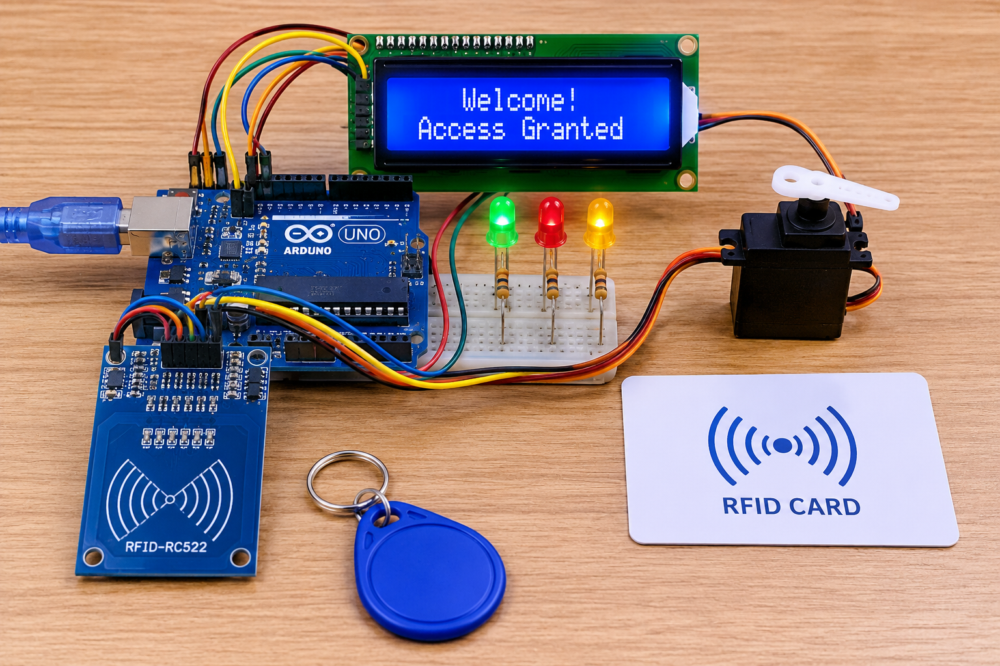
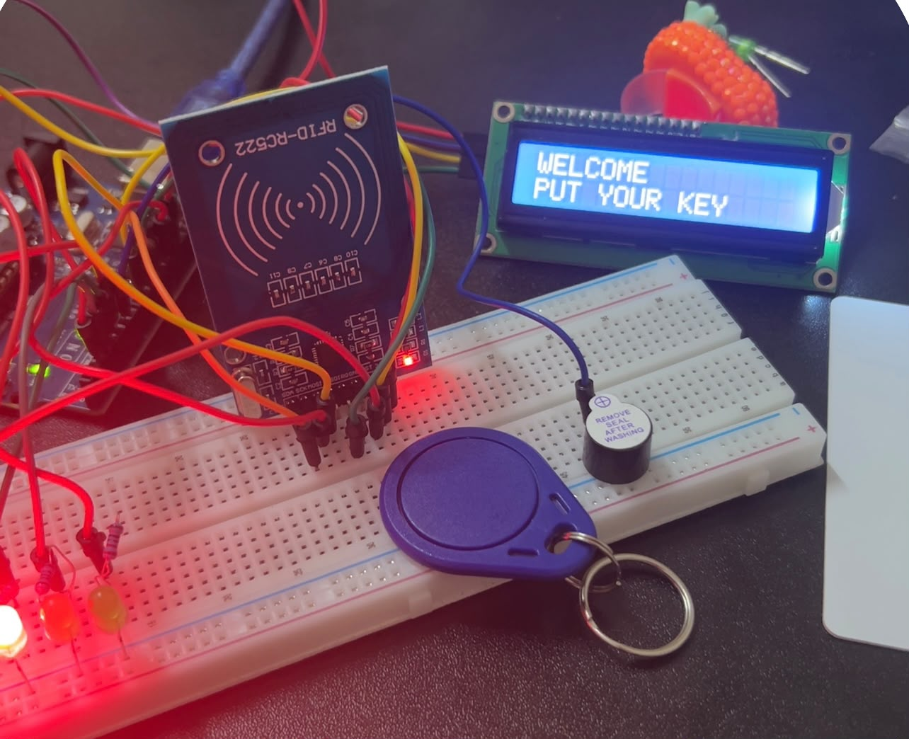

# RFID-Access-Control-System
An Arduino-based RFID access control system using the RC522 module to identify authorized cards. The project includes an LCD display, LEDs, and a buzzer to provide visual and audio feedback. Developed as an introductory embedded systems and IoT project.
## Project Images

## Project Video

[Watch the project demonstration](images/rfid-demo.mp4.mp4)
